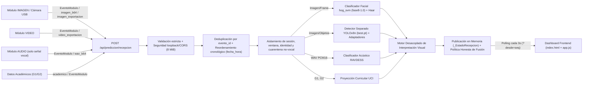

# Guía de Integración — Módulo PREDICCIÓN (AulaPredict)

> **Estado:** Vigente (Fase 13C — Entrega Final Unificada)  
> **Ruta del módulo:** `D:\Proyectos\PREDICCION`  
> **Canal HTTP principal:** `POST /api/prediccion/recepcion`, `GET /api/prediccion/recepcion/ultima`, `POST /api/prediccion/recepcion/reiniciar`, `GET /api/prediccion/diagnostico`  
> **Política editorial:** PREDICCIÓN evalúa modalidades de forma independiente, publica interpretaciones visuales basadas estrictamente en hechos observables, prohíbe diagnósticos psicológicos/familiares/económicos, y no promedia probabilidades entre fuentes heterogéneas sin un modelo multimodal calibrado.

---

## 1. Arquitectura General y Flujo de Datos



---

## 2. Endpoints HTTP Disponibles

Todos los endpoints restringen el acceso a red local (`127.0.0.1`, `::1`, `localhost`), rechazan cabeceras de proxy (`X-Forwarded-For`, `Forwarded`, `X-Real-IP`) u `Origin`/`Host` externos con `HTTP 403`, imponen límite de cuerpo de `8 MiB` (`HTTP 413`), omiten reflejar datos de entrada en `HTTP 422` y devuelven `Cache-Control: no-store`.

| Método y Ruta | Propósito | Notas |
| --- | --- | --- |
| `POST /api/prediccion/recepcion` | Recibir eventos normalizados, señales directas o exportaciones IMAGEN/VIDEO, evaluar cada modalidad por separado y publicar al panel. | Soporta envío parcial de una o varias modalidades. |
| `GET /api/prediccion/recepcion/ultima?desde=0` | Consultar el último paquete publicado para el dashboard (polling automático cada 3 s en `frontend/app.js`). | Devuelve `{"sin_cambios": true}` cuando `actualizacion_id <= desde`. |
| `POST /api/prediccion/recepcion/reiniciar` | Limpiar el resultado publicado en memoria y reiniciar el historial de deduplicación. | Incrementa `actualizacion_id` para evitar rehidrataciones obsoletas. |
| `GET /api/prediccion/diagnostico` | Consultar estado del canal de recepción, versión/disponibilidad de modelos cargados y garantías activas. | No expone datos personales ni payloads almacenados. |
| `POST /api/prediccion/analisis-experimental` | Análisis directo utilizado por la cámara USB y carga de fotografía en el dashboard. | Conserva compatibilidad total con `frontend/app.js`. |
| `GET /api/salud` / `GET /api/modulos` | Salud del servicio FastAPI y detección de carpetas de módulos hermanos (`imagen`, `video`, `audio`). | Preservados sin cambios de contrato. |
| `POST /api/prediccion/orquestar` / `/estudiantes` | Endpoints existentes de seguimiento y orquestación interna. | Preservados con sus contratos originales. |

---

## 3. Esquemas JSON Versionados (`schema_version: 1`)

### 3.1 Contrato raíz de entrada: `EntradaRecepcion`

```json
{
  "schema_version": 1,
  "sesion_id": "aula-101-sesion-1",
  "ventana_captura": {
    "inicio": "2026-05-01T10:00:00Z",
    "fin": "2026-05-01T10:15:00Z"
  },
  "solicitar_fusion": false,
  "publicar_en_panel": true,
  "imagen": null,
  "video": null,
  "audio": null,
  "academico": null,
  "imagen_exportacion": null,
  "video_exportacion": null,
  "eventos": []
}
```

> Todos los campos de fuente son opcionales e independientes: basta enviar cualquiera de ellos (`imagen`, `video`, `audio`, `academico`, `imagen_exportacion`, `video_exportacion` o `eventos`).

### 3.2 Esquema de cada elemento en `eventos`: `EventoModulo`

```json
{
  "evento_id": "img-evt-20260501-0001",
  "modulo": "imagen",
  "estudiante_id": null,
  "estado_identidad": "desconocida",
  "sesion_id": "aula-101-sesion-1",
  "fecha_hora": "2026-05-01T10:02:14Z",
  "tipo_observacion": "objeto",
  "datos_observados": {
    "objetos": [
      { "clase": "telefono", "confianza": 0.91 }
    ]
  },
  "resultados_modelo": null,
  "confianza": 0.91,
  "calidad": 0.95,
  "version_modelo": "yolov8n-best-1.0",
  "trazabilidad": { "camara": "aula-norte" }
}
```

* Valores permitidos de `modulo`: `"imagen"`, `"video"`, `"audio"`, `"academico"`.
* Valores permitidos de `estado_identidad`: `"desconocida"` (por defecto), `"verificada"`, `"ambigua"`.
* Valores permitidos de `tipo_observacion`: `"facial"`, `"objeto"`, `"vocal"`, `"asistencia"`, `"transcripcion"`, `"academico"`, `"frame"`, `"alerta"`, `"desconocida"`.

---

## 4. Ejemplos por Módulo Externo

### 4.1 Módulo IMAGEN (objetos detectados sin requerir píxeles ni notas)

```json
{
  "schema_version": 1,
  "sesion_id": "aula-101",
  "eventos": [
    {
      "evento_id": "img-001",
      "modulo": "imagen",
      "sesion_id": "aula-101",
      "fecha_hora": "2026-05-01T10:01:05Z",
      "tipo_observacion": "objeto",
      "datos_observados": {
        "objetos": [
          { "clase": "telefono", "confianza": 0.89 },
          { "clase": "cuaderno", "confianza": 0.82 }
        ]
      }
    }
  ]
}
```

También puede enviarse el JSON nativo exportado por IMAGEN en `"imagen_exportacion"` (con `frames[].frame_id`, `segundo` o `timestamp`, y `objetos[].clase` / `confianza_procesada` / `estado`) o una fotografía base64 en `"imagen": {"imagen_b64": "...", "modelo_facial": "real"}`.

### 4.2 Módulo VIDEO (exportación nativa o eventos por fotograma)

```json
{
  "schema_version": 1,
  "sesion_id": "aula-101",
  "video_exportacion": {
    "schema_version": 1,
    "modulo": "video",
    "modelo": "SistemaSupervisionExamenes/best.pt",
    "frames": [
      {
        "frame_id": 12,
        "segundo": 4.5,
        "detecciones": [
          { "clase": "person", "confianza": 0.93 },
          { "clase": "laptop", "confianza": 0.86 }
        ]
      }
    ]
  }
}
```

### 4.3 Módulo AUDIO (vocal compatible vs cuarentena de asistencia/transcripción)

- **Entrada vocal válida (WAV PCM16, 8–48 kHz, ≤ 8 s):**
  `"audio": {"wav_b64": "<base64_pcm16>"}`
- **Eventos no vocales rechazados en cuarentena (no se envían al modelo RAVDESS):**
  Si `modulo: "audio"` llega con `tipo_observacion: "asistencia"` o `"transcripcion"`, PREDICCIÓN aisla el evento con estado `"tipo_incompatible_no_vocal"` sin contaminar el análisis acústico ni interrumpir otras modalidades.

### 4.4 Módulo ACADÉMICO (independiente de cámara y audio)

```json
{
  "schema_version": 1,
  "academico": {
    "G1": 15,
    "G2": 16,
    "corte": "despues_g2",
    "escala": "0-20"
  }
}
```

Si falta `G1` o `G2`, PREDICCIÓN devuelve `estado: "evidencia_insuficiente"` con `campos_faltantes` y **no** imputa calificaciones ni extrapola desde la expresión facial.

---

## 5. Ejemplo de Salida JSON (`POST /api/prediccion/recepcion`)

```json
{
  "schema_version": 1,
  "actualizacion_id": 4,
  "sesion_id": "aula-101",
  "estado": "procesado",
  "errores": {},
  "trazabilidad_eventos": {
    "recibidos": 1,
    "elegibles": 1,
    "duplicados_omitidos": 0,
    "duplicados_ids": [],
    "contradictorios": [],
    "reordenados_cronologicamente": false,
    "excluidos": []
  },
  "analisis": {
    "fuentes": {
      "imagen": {
        "estado": "abstencion",
        "rostros_detectados": 1,
        "identidad_verificada": false,
        "deteccion_objetos": {
          "estado": "ejecutado",
          "objetos": [{ "clase": "reloj", "etiqueta": "Reloj", "confianza": 0.72, "origen": "yolo_best_local" }],
          "objetos_no_persona": [{ "clase": "reloj", "etiqueta": "Reloj", "confianza": 0.72, "origen": "yolo_best_local" }]
        }
      },
      "video": { "estado": "sin_entrada" },
      "audio": { "estado": "sin_entrada" }
    },
    "academico": { "estado": "sin_entrada" },
    "interpretacion_visual": {
      "version": "1.0.0",
      "observaciones": ["..."],
      "clasificaciones": ["..."],
      "hipotesis": [
        {
          "tipo": "posibilidad_general_no_evaluada",
          "descripcion": "Cansancio o fatiga acumulada",
          "es_prediccion_individual": false,
          "probabilidad_asignada": null
        }
      ],
      "predicciones": [],
      "limitaciones": ["..."],
      "evidencia_requerida": ["..."],
      "resumen": {
        "observacion_visual": "...",
        "interpretacion": "...",
        "informacion_adicional_necesaria": "..."
      }
    }
  },
  "fusion": {
    "ejecutada": false,
    "metodo": "sin_modelo_conjunto_validado",
    "explicacion": "No existe un modelo multimodal conjunto calibrado entre estas fuentes heterogéneas; cada modalidad reporta su evidencia e incertidumbre por separado sin promediar probabilidades."
  }
}
```

---

## 6. Reglas de Seguridad, Identidad, Sesiones, Deduplicación y Tiempo

1. **Identidad por defecto desconocida:** Todo resultado sin verificación explícita emite `identidad_verificada: false`. Si distintos eventos dentro de un lote aportan `estudiante_id` verificados contradictorios o un evento viene con `estado_identidad: "ambigua"`, el módulo marca conflicto `identidades_contradictorias` y fuerza `identidad_verificada: false` en todas las fuentes visuales/acústicas de ese ciclo.
2. **Aislamiento por sesión y ventana:** Si `sesion_id` del envoltorio difiere de un evento, el evento se excluye antes de inferir con motivo `"sesion_distinta"`. Si existe `ventana_captura`, los eventos sin fecha o fuera de `[inicio, fin]` se excluyen como `"fecha_faltante"` o `"captura_fuera_de_ventana"`.
3. **Deduplicación e idempotencia (`evento_id`):** `_EstadoRecepcion` retiene las huellas SHA-256 de los últimos `256` `evento_id`. Un reenvío idéntico incrementa `duplicados_omitidos` y se omite sin reprocesar; un mismo `evento_id` con distinto contenido se bloquea y reporta en `contradictorios`.
4. **Orden cronológico:** Eventos recibidos fuera de orden se ordenan ascendentemente por `fecha_hora` antes de aplicar las ventanas/modalidades y marcan `reordenados_cronologicamente: true`.
5. **Privacidad en memoria:** Los resultados recibidos por `/recepcion` permanecen únicamente en memoria RAM volátil (`_EstadoRecepcion`) y nunca escriben imágenes, audios ni identificadores en disco.

---

## 7. Abstención, Incertidumbre y Auditoría del Modelo Facial

* **Umbrales vigentes de decisión facial (`hog_svm`, versión `fase8-1.0`):** probabilidad calibrada mínima `0.55` y margen mínimo sobre la segunda clase `0.10`. Si no se cumplen, el sistema emite `estado: "abstencion"` con las 4 probabilidades (`alegria`, `tristeza`, `enojo`, `neutral`) e hipótesis no concluyente.
* **Posibilidades generales:** Las explicaciones contextuales no evaluadas (`cansancio`, `carga académica`, `concentración`, etc.) mantienen siempre `es_prediccion_individual: false` y `probabilidad_asignada: null`.
* **Auditoría reproducible de Fase 13C ([fase13_auditoria_facial.json](fase13_auditoria_facial.json)):**
  - Ejecutada con `.\backend\.venv\Scripts\python.exe -m backend.entrenamiento_prediccion.auditar_facial_fase13` sobre `cmu-face-images.zip` con `GroupKFold` por sujeto (`n_splits=4`, cero fuga de identidad entre entrenamiento y prueba).
  - Resultados de la línea base (`fase8-1.0` HOG+SVM): `accuracy_prueba = 0.3684`, `f1_macro_prueba = 0.308`, `ece_10_tramos = 0.0219`, `log_loss = 1.3464`.
  - Los 6 modelos candidatos evaluados (HOG+LogisticRegression L2/L1, LBP+HOG+LinearSVC, HOG+PCA+SVM RBF, MLP ligero y HOG multiescala) obtuvieron `F1-macro <= 0.4002` en validación cruzada estricta frente a `0.4365` de la línea base, debido a la limitación estructural del corpus actual (196 muestras válidas en 20 sujetos; `fer2013.csv` ausente).
  - **Decisión técnica documentada:** `conservar_modelo_vigente` (`fase8-1.0`). No se reemplaza sin mejora medible reproducible ni compromiso de calibración. Para superarlo en fases futuras basta incorporar un conjunto etiquetado amplio de expresiones (`FER-2013` o `RAF-DB`) mediante `entrenar_fase8.py` manteniendo compatibilidad binaria con `joblib` y el plan de reversión instantáneo al artefacto `fase8-1.0`.

---

## 8. Dependencias, Pesos y Ejecución Local

### 8.1 Modelos y licencias

* **Clasificador facial:** `hog_svm` (`fase8-1.0`, scikit-learn / Joblib).
* **Detector de objetos separado:** `backend/modelo_ia/best.pt` (`YOLOv8n`, Ultralytics, **licencia AGPL-3.0**). Clases soportadas: `persona`, `mochila`, `telefono`, `cuaderno`, `libro`, `audifonos`, `reloj`, `laptop`. Puede desactivarse sin afectar la inferencia facial definiendo `AULAPREDICT_DETECTOR_OBJETOS=off`.
* **Audio y académico:** modelos calibrados RAVDESS (`phase8` / `phase7`) y UCI Student Performance (`phase7`).

### 8.2 Levantar servidor y ejecutar pruebas

```powershell
# 1. Activar entorno e iniciar FastAPI + Dashboard estático
.\backend\.venv\Scripts\python.exe -m uvicorn backend.app:app --host 127.0.0.1 --port 8001

# 2. Suite completa de pruebas Python (incluye Entrega Final Unificada)
.\backend\.venv\Scripts\python.exe -m pytest -q

# 3. Suite automatizada Frontend + integración HTTP en Node.js
node --test tests/test_frontend.cjs

# 4. Verificación integral del proyecto
.\verificar_aulapredict.bat --fusion
```

---

## 9. Limitaciones Documentadas y Acciones para Otros Módulos

### Limitaciones del sistema actual

1. No existe un modelo multimodal conjunto calibrado entre rostro, objetos, audio actuado RAVDESS y notas UCI; la fusión entre fuentes heterogéneas permanece bloqueada por honestidad científica.
2. El modelo facial (`196` imágenes reales de 20 sujetos CMU) presenta baja potencia de generalización en 4 categorías y entra en abstención frecuente ante iluminación pobre o poses no frontales.
3. Una fotografía puntual no acredita uso indebido de dispositivos (`telefono`, `reloj`, `audifonos`), atención sostenida ni riesgo de reprobación.

### Lista de acciones para los equipos integradores

- **Equipo IMAGEN:** Enviar detecciones en el contrato de `EventoModulo` (`modulo: "imagen"`, `tipo_observacion: "objeto"`) o exportación estándar hacia `POST /api/prediccion/recepcion`, incluyendo siempre `sesion_id`, `fecha_hora` ISO-8601 con zona (`Z` u offset), `evento_id` único e inmutable y `estado_identidad: "desconocida"` salvo enlace biométrico auditado.
- **Equipo VIDEO:** Mantener trazabilidad por ventana temporal (`sesion_id`, `fecha_hora`) e indicar en cada detección multi-persona que los `track_id` son identificadores visuales de seguimiento y no identidades escolares reales.
- **Equipo AUDIO:** Cuando el módulo esté habilitado, enviar únicamente fragmentos vocales PCM16 (`8–48 kHz`, ≤ `8 s`) o descriptores acústicos bajo `tipo_observacion: "vocal"`, marcando explícitamente asistencias o transcripciones de texto con su `tipo_observacion` correspondiente para evitar su envío erróneo al modelo acústico.
